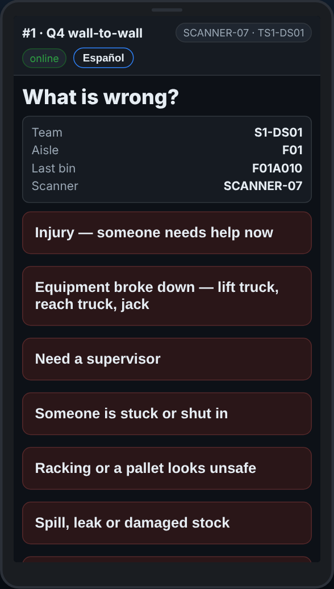
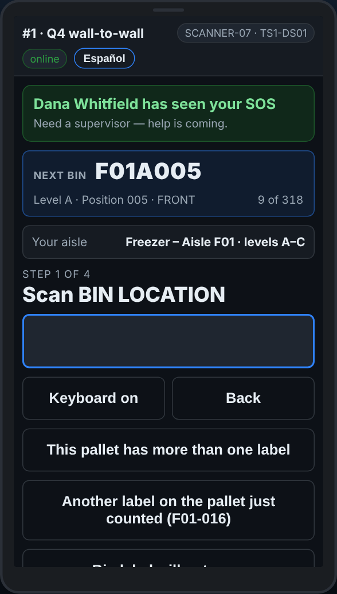

# On the scanner — SOS — when you need help now

**Role:** Everyone counting on a full count  **When:** someone is hurt, stuck, equipment is broken, or you need a supervisor right away

SOS tells the office at once, with your team, your aisle and the last bin you scanned. When a supervisor picks it up, your scanner tells you who.

## What you see

*SOS — what is wrong? Pick it, and the office is told at once.*

*When a supervisor picks it up, the scanner says who has seen it.*

## What to do

1. Tap the red **SOS — I need help**.
2. Pick what is wrong. Add a note if there is time.
3. Stay where you are if it is safe. The office sees your team, aisle and last bin.
4. When a supervisor presses *I am on it*, your scanner says who has seen it.
5. No signal: the scanner says the SOS was **not** sent. Go and find someone.

## What the office sees

A loud alert on the Dashboard under **Alerts**, and in the Teams channel if the site has one, with your team, aisle, last bin and what you picked.

## Do not

- Do not wait for the scanner if someone is in danger: shout, and go for help.
- Do not use SOS for a damaged pallet or a blocked spot: use Report a problem.
