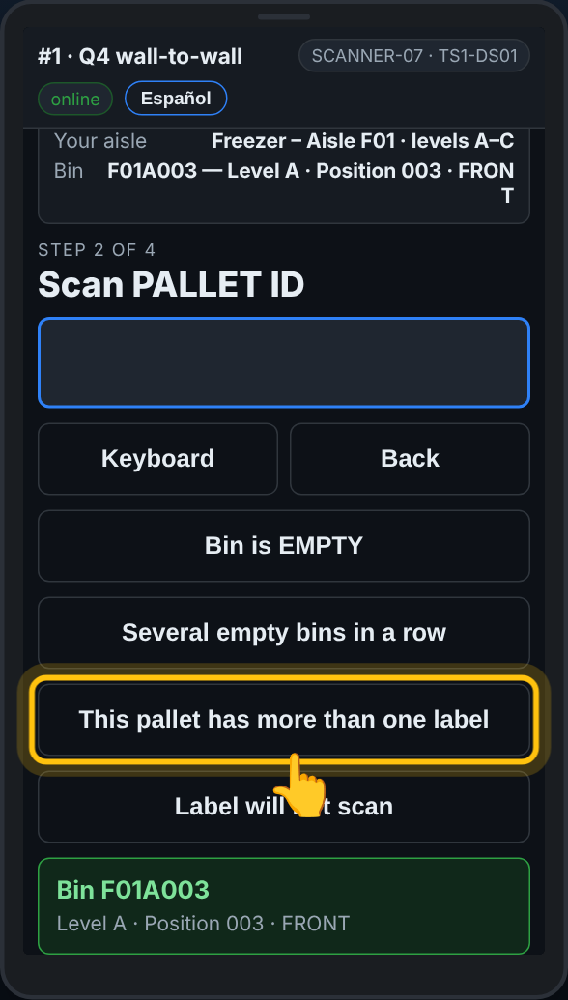
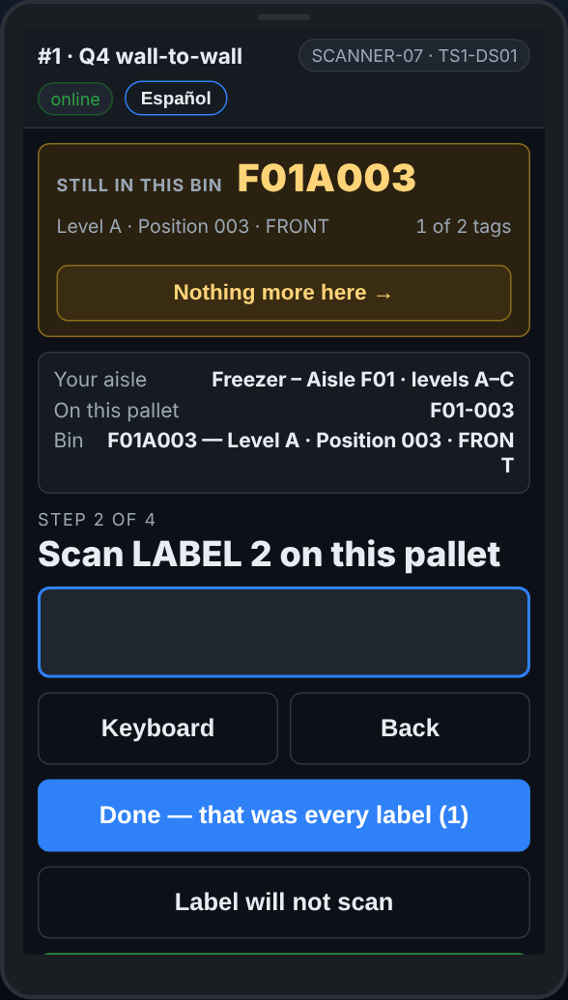
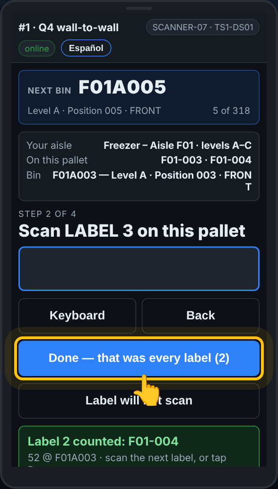

# On the scanner — A pallet with two or more labels

**Role:** Everyone counting on a full count  **When:** one pallet carries more than one pallet label

Some pallets carry two loads on one skid, each with its own label. Each label is counted on its own, with its own quantity, in the same bin. The rack label is scanned once for all of them.

## What you see

*Before anything is scanned, or with only the rack label in: This pallet has more than one label.*

*Label 2 on this pallet: each label gets its own quantity.*

*Done — that was every label, with the count of labels on it.*

## What to do

1. Scan the rack label as usual.
2. Tap **This pallet has more than one label**. If you tap it before the rack label, the scanner asks for the bin first: *Scan the BIN this pallet is in*.
3. The screen says *Scan LABEL 1 on this pallet*. Scan the first label, then type the cases that label covers and press Enter.
4. The screen says *Scan LABEL 2 on this pallet*. Scan the second label and type its cases. Go on for every label.
5. Tap **Done — that was every label**. The button shows how many labels you counted.

**Saw the second label too late?** The pallet is already saved. At the start of the next line tap **Another label on the pallet just counted**. The scanner keeps the same bin: scan the other label, type its cases, then **Done**.

**Second label says Pallet not on the list?** Tap **It is another label on the pallet with …** and it is counted with the first one.

## What the office sees

Each label is its own row on the pallet report, in the same bin, with its own quantity. The later labels say which label they share a pallet with, so nobody reads the pallet as counted twice.

## Do not

- Do not add the two quantities together on one label.
- Do not scan the same label twice, or the rack label again between labels.
