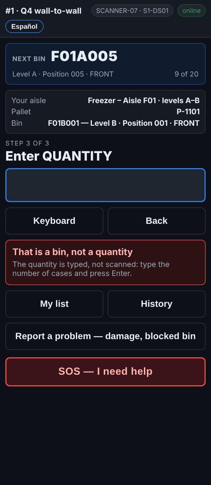

# On the scanner — The wrong label in the wrong box

**Role:** Everyone counting on a full count  **When:** you scan a rack label where the pallet goes, a pallet label where the bin goes, or a label into the quantity

The scanner knows a rack label from a pallet label. When the wrong one goes in, it says so and records nothing.

## What you see

*That is a bin, not a quantity: the quantity is typed, not scanned.*

## What to do

1. Read the red message. It says what you scanned and what it wanted:
   - *… is a bin, not a pallet*: scan the pallet label.
   - *… is a pallet label, not a bin*: scan the rack label of the spot the pallet is in.
   - *That is a bin, not a quantity*: type the number of cases and press Enter.
2. Scan or type the right thing. Nothing was recorded by the wrong scan.

## What the office sees

Nothing. A wrong scan never reaches the office.

## Do not

- Do not scan a label to fill the quantity box.
- Do not tap Back to get rid of the message: just scan the right label.
