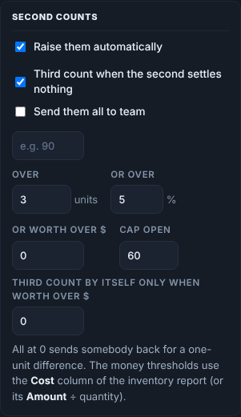

# How to — Set up second and third counts

**Role:** Admins and inventory control  **Login profile:** Admin (the settings), any login with the Dashboard and *Queue aisles, raise second counts* for the day itself  **Pages:** Settings → Lists & racking, Settings → Count setup, Teams & crew, Dashboard → Second counts, Testing Suite  **Functions:** the inventory report's costs, the second-count thresholds in cases, percent and money, third counts, the second-count team, approvals, a dry run

This guide is the set-up only: what to load, what to switch on, what numbers to put in the
thresholds and why, and how to prove it works before count day. How a second count is done on
the gun, how it is judged and how the list is worked to zero is in **Second and third counts**;
this one gets you to the point where that guide takes over.

## Contents

- [1 — What you are setting up](#1--what-you-are-setting-up)
- [2 — Before you start: the report with costs](#2--before-you-start-the-report-with-costs)
- [3 — The settings, in order](#3--the-settings-in-order)
- [4 — Choosing the thresholds](#4--choosing-the-thresholds)
- [5 — Third counts](#5--third-counts)
- [6 — One team for the second counts](#6--one-team-for-the-second-counts)
- [7 — Approvals, with the same thresholds](#7--approvals-with-the-same-thresholds)
- [8 — Prove it in the Testing Suite](#8--prove-it-in-the-testing-suite)
- [9 — Count day: what to watch](#9--count-day-what-to-watch)
- [10 — Checklist](#10--checklist)

## 1 — What you are setting up

Every pallet a team counts is compared with the inventory report. When the two disagree, the app
can send a **different** team back to that bin to count it again, blind — a **second count**. When
the second count agrees with neither the first count nor the report, it can send a **third** team —
a **third count** — and that count stands.

What you decide here is **which differences are worth a walk**. Set nothing, and every one-bag
difference on every pallet comes back; on a wall-to-wall that is hundreds of bins by mid-morning
and the list is longer than the count. Set it too tight, and a $2,000 miss slips through because it
was only 3 %. The app lets you say it three ways — **cases**, **percent of the pallet**, and **money**
— and any one of them is enough to raise the second count.

## 2 — Before you start: the report with costs

The money thresholds need a cost on the pallet. They come from the inventory report.

**Settings → Lists & racking → Inventory report.** Upload the report as the system exports it, with
the **Cost** column (the unit cost) and the **Amount** column (quantity × cost). Either one with the
quantity is enough — the app works the other out — but the export has both, so leave both in.

| Bin Code | Container No. | … | Quantity | … | System | Cost | Amount |
|---|---|---|---|---|---|---|---|
| A01A001 | FR10247661 | … | 2,400. | … | JustFood | 0.16589 | 398.136 |
| A01A003 | FR10006042 | … | 34,025. | … | JustFood | 0.08591 | 2923.08775 |

**How you know it worked.** The upload card says how many pallets it read; **⬇ Download the
loaded report** gives the file back with the Cost and Amount columns filled. On **Dashboard →
Reports → Pallet report** the **Cost** and **Report $** columns are there (they only appear when
the report carries costs), and **Progress** shows the report's total value.

**Rows with no cost.** An ERP export often prices some of an item's entries and not others (a
cost not adjusted yet). A row with no cost takes its **item's** cost from the report's other rows of
that item — the upload summary says how many — and the download marks them *item* in **Cost
Source**; on the pallet report that cost is dimmed. An item with **no cost anywhere** is judged by
the case and percent thresholds alone, its money columns stay blank, and the upload summary names
it, so inventory control can price it in the ERP and upload again.

> The counters never see a cost. Nothing about money goes to the scanners.

## 3 — The settings, in order

**Settings → Count setup → Count session**, with the count picked at the top of the page. Under
**Second counts**:

*The Second counts settings on the count.*

1. **Raise them automatically** — tick it. Second counts are raised the moment a first count
   disagrees with the report by more than the thresholds, and when an aisle is marked done with a
   pallet in it nobody saw. (Untick it only if inventory control wants to raise every one by hand
   with **Raise from all variances now**.)
2. **Over N units** — the difference in cases (bags, boxes — the report's unit) that raises a
   second count on its own.
3. **or over N %** — the difference as a share of what the report said was on the pallet.
4. **or worth over $N** — the difference at the report's unit cost.
5. **Cap open** — stop raising automatic second counts once this many are open at once. 0 is no
   cap.
6. **Third count when the second settles nothing** — tick it for a wall-to-wall (section 5).
7. **Third count by itself only when worth over $N** — the money floor for an automatic third
   count (section 5).
8. **Send them all to team** — one team for every second count (section 6), or leave it off and any
   team that did not do the first count can take them.

Press **Save settings**. A change applies from then on — it does not go back over lines already
in. Set it before the count starts.

## 4 — Choosing the thresholds

**Any one threshold raises the second count.** The case threshold catches a big miss on a cheap
item; the percent threshold catches a small pallet that is mostly wrong; the money threshold
catches an expensive item where even a few cases matter. Leave one at 0 to switch that test off.

Worked with the report above:

| Pallet | Report | Counted | Difference | Over 50 units? | Over 5 %? | Worth over $100? | Second count raised? |
|---|---|---|---|---|---|---|---|
| Mango 32oz at $0.16589 | 2,400 | 2,500 | +100 bags · +$16.59 | yes | no (4 %) | no | **yes** — by cases |
| Blackberries 10oz at $0.08591 | 34,025 | 33,000 | −1,025 · −$88.06 | yes | no (3 %) | no | **yes** — by cases |
| Family pack at $0.21708 | 2,400 | 1,400 | −1,000 · −$217.08 | yes | yes (42 %) | yes | **yes** — by all three |
| Mango 32oz | 2,400 | 2,390 | −10 · −$1.66 | no | no | no | no |
| An item at $4.20 a case | 120 | 90 | −30 · −$126.00 | no | yes (25 %) | yes | **yes** — by percent and money |
| The same at $4.20 | 1,200 | 1,170 | −30 · −$126.00 | no | no (2.5 %) | yes | **yes** — by money alone |

The last row is the one the money threshold exists for: thirty cases on a big pallet is nothing in
percent and under the case floor, and it is still $126 of stock.

**Starting points**

| Count | Over N units | or over N % | or worth over $N | Cap open |
|---|---|---|---|---|
| Wall-to-wall, mixed stock | 2–5 | 5–10 | 200–500 | 50–100 |
| Wall-to-wall, high-value stock | 1–2 | 5 | 100 | 100 |
| Cycle counts, a few bins a day | 1 | 0 | 50 | 0 |
| A trial run or training | 0 | 0 | 0 | 20 |

**Money only.** Set the units and percent to 0 and the money to, say, $150: only differences worth
$150 or more come back, whatever the case count. Pallets with no cost on the report then never
raise a second count by quantity — give them a case threshold too if that matters.

**Reading the result.** After a batch of counts lands, **Dashboard → Second counts** shows what was
raised, and **Raise from all variances now** says how many it left alone as *under the threshold*.
If the list is growing faster than the second-count team can walk it, raise the numbers; if the
pallet report's **Difference $** column shows big misses with no second count against them, lower
the money one.

## 5 — Third counts

Tick **Third count when the second settles nothing** for any count that will be audited. A bin
whose second count agrees with **neither** the first count nor the report is counted a third time,
by a team that did neither, and the third count stands on every report.

**Third count by itself only when worth over $N** keeps the automatic third counts to the bins that
matter. With it at **$500**: a bin whose second count is $130 away from the report is left as it is
— the second count stands, and inventory control can still press **3rd count** on the dashboard to
send somebody. A bin $600 away goes back by itself. A bin with no costs on it always goes back,
because nobody can say what it is worth. At **0**, every unsettled bin goes back.

The money is the gap between the **second count and the report**, pallet by pallet, at the report's
cost: 2,400 on the report, 1,800 on the second count, at $0.21708 — $130.25.

## 6 — One team for the second counts

Many sites give the second counts to one crew — inventory control's own, say — rather than
whichever team is nearest. **Send them all to team** with the team number does that: every new
second count is theirs. A bin that team counted first stays open for any other team, because the
team that did the first count never does the second.

Set the team up first on **Teams & crew → Teams** with the equipment to reach every level (a
second count can be anywhere), and give it its card. The *Second and third counts* guide, section
7a, covers handing them on to other teams during the day.

## 7 — Approvals, with the same thresholds

Under **Adjustments** on the same card, **Adjustments need approval** makes every difference from
the report wait for a signature and a reason before it reaches the ERP file. Its thresholds work
the same way as the second-count ones — **Approve over N units**, **or over N %**, **or worth over
$N**, any one is enough — and say which differences are big enough to need a signature. Below all
three, the adjustment goes through on its own.

A sensible pair: second counts at **$200**, approvals at **$100** — everything that was walked twice
is signed for, and the small stuff between $100 and $200 is signed for without a walk.

## 8 — Prove it in the Testing Suite

Do this the week before, not on the morning.

1. **Testing Suite** in the side panel: open the practice count. Its settings are its own, so set
   the same thresholds there (the practice count has costs on its pallets).
2. On the practice gun, count a pallet **10 under**, one **100 under**, and one **wrong by half**.
3. **Dashboard → Second counts** on the practice count: the 100-under and the half-wrong bins are
   on the list; the 10-under is not. **Raise from all variances now** says *1 under the threshold*.
4. Sign the practice gun on as a **different** team and do one of the second counts with a number
   that agrees with neither. With third counts on, the bin comes back as **THIRD COUNT**.
5. **Reports → Pallet report**: the **Difference $** column shows each miss in money; **Adjustments
   → Positive and negative** shows the dollars under the units.

If any of that is not what you see, nothing has gone to the real count yet — fix the settings and
go again.

## 9 — Count day: what to watch

- **Dashboard → Second counts** — the open number. If it climbs faster than it falls, the
  thresholds are too low or the second-count team is short: raise the money threshold first, it
  bites on the cheapest stock.
- **Progress → Difference so far** — the count's running variance in money, over and under. A
  number that jumps after one aisle is a team, not the stock.
- **Pallet report → Difference $**, sorted — the biggest misses, with or without a second count
  against them. **Recount** on a row sends somebody without changing the thresholds.
- Do not loosen the thresholds mid-count to make the list shorter; the lines already in are not
  re-judged, so you get a list that was built two ways. Raise the **Cap** instead, or add a team.

## 10 — Checklist

- ☐ Inventory report uploaded with **Cost** and **Amount**; Pallet report shows a Cost column
- ☐ **Raise them automatically** on
- ☐ **Over N units / or over N % / or worth over $N** set and saved, Cap decided
- ☐ **Third count when the second settles nothing** on, with its money floor decided
- ☐ The second-count team made on Teams & crew, with the reach for every level, and named under
  **Send them all to team** if one team does them
- ☐ Approvals on or off, with their thresholds
- ☐ Dry run in the Testing Suite: a small miss left alone, a big one raised, a third count raised
- ☐ Inventory control knows where the list is and what **Raise from all variances now** does
